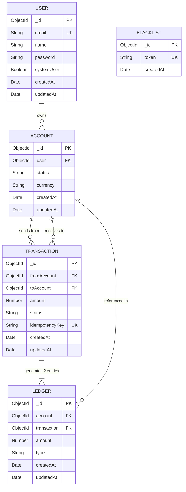
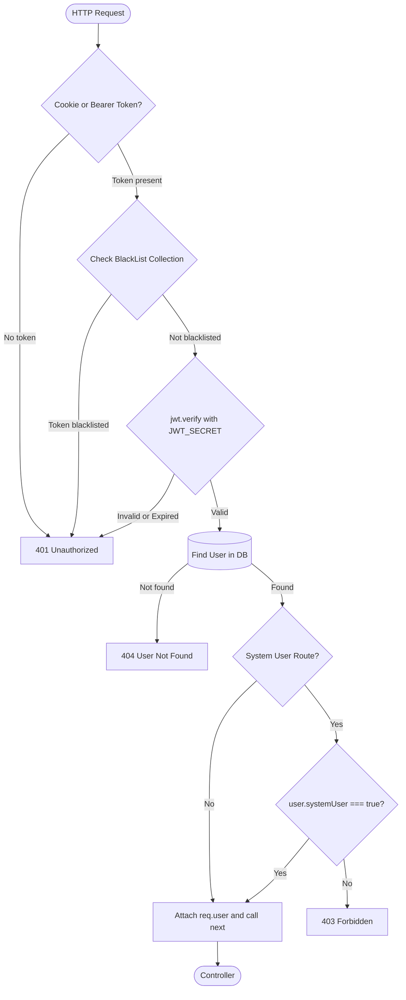
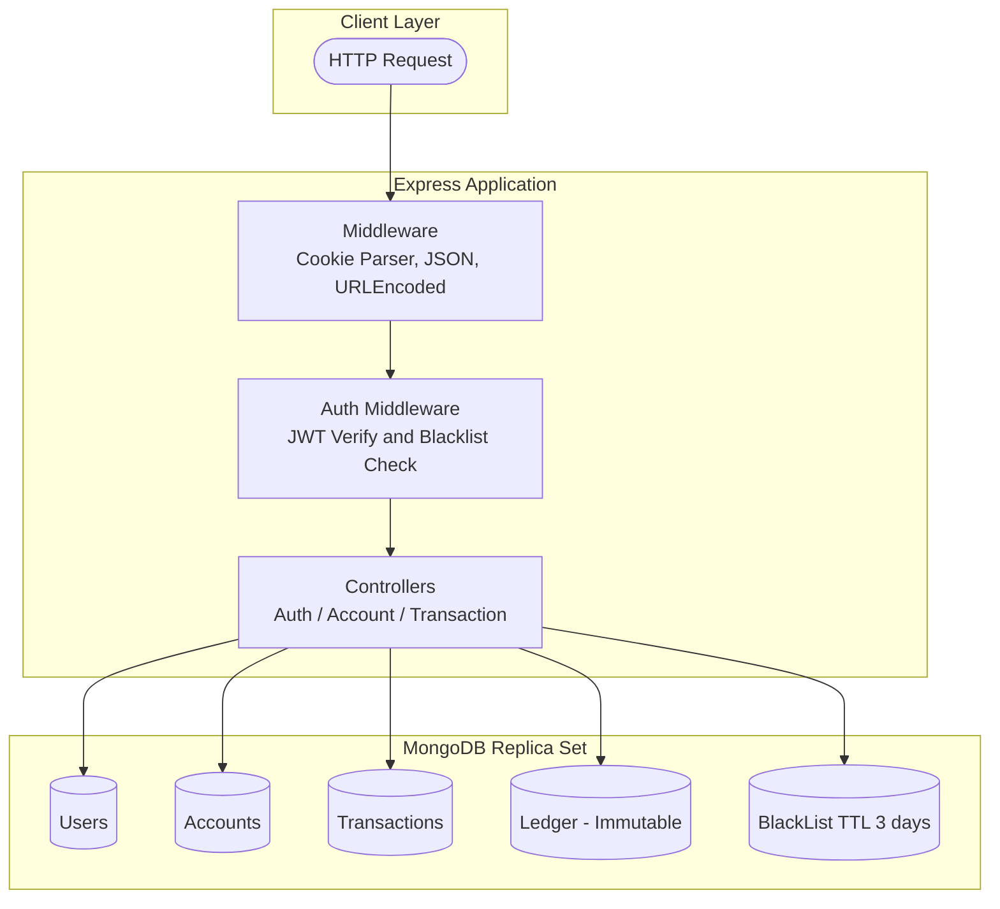

# 🏦 Bank Ledger System — Backend API

<div align="center">


**A production-grade, double-entry accounting ledger system built on Node.js, Express & MongoDB.**  
Designed with financial-grade atomicity, idempotency, and immutable audit trails at its core.

</div>

---

## 📋 Table of Contents

- [Overview](#-overview)
- [Core Financial Design Principles](#-core-financial-design-principles)
- [Tech Stack](#-tech-stack)
- [Project Structure](#-project-structure)
- [Data Models & Relationships](#-data-models--relationships)
- [Transaction Flow & Atomicity](#-transaction-flow--atomicity)
- [API Reference](#-api-reference)
- [Authentication Architecture](#-authentication-architecture)
- [Getting Started](#-getting-started)
- [Environment Variables](#-environment-variables)
- [Security Considerations](#-security-considerations)

---

## 🌐 Overview

The **Bank Ledger System** is a backend API that simulates core banking operations including user registration, account management, peer-to-peer fund transfers, and initial fund provisioning. The system is built around the **double-entry bookkeeping principle** — every financial movement creates exactly two immutable ledger entries: one DEBIT and one CREDIT.

Key design priorities:
- ✅ **Atomicity** — MongoDB multi-document ACID transactions via sessions
- ✅ **Idempotency** — Duplicate transaction prevention via unique idempotency keys
- ✅ **Immutability** — Ledger records are write-once; modification is explicitly blocked
- ✅ **Audit Trail** — Every balance derived from ledger history, never stored as a mutable field
- ✅ **Role-based Access** — Separate middleware guards for standard users vs. system users

---

## 💡 Core Financial Design Principles

### 1. Double-Entry Bookkeeping (No Stored Balance)
The account model has **no `balance` field**. Balance is always computed on demand using MongoDB aggregation over the `LEDGER` collection:

```
Balance = Σ(CREDIT entries) − Σ(DEBIT entries)
```

This eliminates the risk of balance desync and provides a tamper-evident audit log.

### 2. Ledger Immutability
The `LEDGER` model uses Mongoose pre-hooks to throw errors on any `update`, `delete`, or `remove` operation. Once written, a ledger entry is permanent — mirroring real-world accounting standards.

### 3. Idempotency Keys
Every transfer request must include an `idempotencyKey`. Before processing, the system checks for an existing transaction with that key. If found, it returns the cached result rather than processing twice. This makes the API safe for retries under network failures.

### 4. MongoDB ACID Sessions
All write operations during a transfer (create TRANSACTION → write DEBIT ledger → write CREDIT ledger → mark COMPLETED) are wrapped in a **single MongoDB session with `startTransaction()` / `commitTransaction()`**. If any step fails, the entire operation rolls back automatically.

---

## 🛠 Tech Stack

| Layer              | Technology                        |
|--------------------|-----------------------------------|
| Runtime            | Node.js                           |
| Framework          | Express.js v5                     |
| Database           | MongoDB (via Mongoose ODM v9)     |
| Authentication     | JWT (jsonwebtoken) + HTTP Cookies |
| Password Hashing   | bcryptjs                          |
| Token Blacklisting | MongoDB TTL Index (3-day expiry)  |
| Dev Server         | nodemon                           |
| Config             | dotenv                            |

---

## 📁 Project Structure

```
Bank_Ledger/
├── server.js                        # Entry point — loads env, connects DB, starts server
├── package.json
├── .env                             # Environment variables (never commit)
└── src/
    ├── app.js                       # Express app setup, middleware, route mounting
    ├── config/
    │   └── db.js                    # MongoDB connection (mongoose.connect)
    ├── model/
    │   ├── user.model.js            # User schema — bcrypt pre-save hook, comparePassword()
    │   ├── account.model.js         # Account schema — getBalance() aggregation method
    │   ├── transaction.model.js     # Transaction schema — idempotency, status lifecycle
    │   ├── ledger.model.js          # Ledger schema — immutable double-entry records
    │   └── blacklist.model.js       # JWT blacklist — TTL auto-expiry after 3 days
    ├── controllers/
    │   ├── auth.controller.js       # Register, Login, Logout
    │   ├── account.controller.js    # Create account, List accounts, Get balance
    │   └── transaction.controller.js# Peer-to-peer transfer, Initial funds provisioning
    ├── routes/
    │   ├── auth.route.js            # POST /api/auth/register|login|logout
    │   ├── account.route.js         # POST|GET /api/account, GET /api/account/balance/:id
    │   └── transaction.route.js     # POST /api/transaction, POST /api/transaction/system/initial-funds
    └── middleware/
        └── auth.middleware.js       # authMiddleware, authSystemUserMiddleware
```

---

## 🗄 Data Models & Relationships

The following ERD shows the complete relationships between all five MongoDB collections:



### Relationship Summary

| Relationship | Type | Description |
|---|---|---|
| `User` → `Account` | One-to-Many | A user can hold multiple accounts (multi-currency) |
| `Account` → `Transaction` (from) | One-to-Many | An account can be the sender of many transactions |
| `Account` → `Transaction` (to) | One-to-Many | An account can be the recipient of many transactions |
| `Transaction` → `Ledger` | One-to-Exactly-Two | Every transaction creates 1 DEBIT + 1 CREDIT ledger record |
| `Account` → `Ledger` | One-to-Many | All DEBIT/CREDIT history for an account lives in LEDGER |
| `BlackList` | Standalone | Stores invalidated JWT tokens with a 3-day TTL expiry |

---

## 🔄 Transaction Flow & Atomicity

The following sequence diagram illustrates the complete lifecycle of a peer-to-peer transfer, showing how the MongoDB session enforces atomicity across all write operations.

```mermaid
sequenceDiagram
    autonumber
    actor Client
    participant Auth as Auth Middleware
    participant TC as Transaction Controller
    participant DB_TX as TRANSACTION Collection
    participant DB_L as LEDGER Collection
    participant Session as MongoDB Session

    Client->>Auth: POST /api/transaction
    Note right of Client: body: fromAccount, toAccount,<br/>amount, idempotencyKey
    Auth->>Auth: Verify JWT token
    Auth->>Auth: Check BlackList
    Auth->>TC: next() with req.user

    Note over TC: PRE-FLIGHT VALIDATION

    TC->>TC: Validate required fields
    TC->>TC: Reject if fromAccount equals toAccount
    TC->>DB_TX: findOne idempotencyKey
    alt Transaction already exists
        DB_TX-->>TC: existing record
        TC-->>Client: 400 or 200 with cached status
    end
    TC->>DB_TX: findOne fromAccount
    TC->>DB_TX: findOne toAccount
    TC->>TC: Assert both accounts ACTIVE
    TC->>DB_TX: ACCOUNT.getBalance via aggregation
    TC->>TC: Assert balance is sufficient

    Note over TC,Session: ATOMIC SESSION BLOCK

    TC->>Session: startSession and startTransaction
    TC->>DB_TX: TRANSACTION.create with status PENDING
    DB_TX-->>TC: transaction document

    TC->>DB_L: LEDGER.create DEBIT entry for fromAccount
    DB_L-->>TC: debit ledger entry

    TC->>DB_L: LEDGER.create CREDIT entry for toAccount
    DB_L-->>TC: credit ledger entry

    TC->>DB_TX: findOneAndUpdate status to COMPLETED

    alt All steps succeeded
        TC->>Session: commitTransaction
        Session-->>TC: committed
        TC->>Session: endSession
        TC-->>Client: 200 OK Transaction completed
    else Any step throws error
        Session->>Session: abort and rollback all writes
        TC->>Session: endSession
        TC-->>Client: 400 Transaction pending try again
    end
```



### Why This Flow Guarantees Atomicity

| Property | How it's achieved |
|---|---|
| **All-or-nothing writes** | `startTransaction()` / `commitTransaction()` on a single session wraps all 4 write ops |
| **No partial state** | If CREDIT ledger creation fails, the DEBIT ledger and TRANSACTION record are rolled back |
| **Idempotency** | `idempotencyKey` (unique index) checked before the session — safe retries |
| **Immutable audit log** | LEDGER pre-hooks block `update`/`delete` — history can never be altered |
| **Balance consistency** | Balance computed from ledger aggregation — never a mutable field that can drift |

---

## 📡 API Reference

All routes are prefixed with the base URL: `http://localhost:{PORT}/api`

### 🔐 Auth Routes — `/api/auth`

| Method | Endpoint | Auth | Body | Description |
|--------|----------|------|------|-------------|
| `POST` | `/register` | ❌ | `{ email, name, password }` | Register a new user. Returns JWT in cookie + body. |
| `POST` | `/login` | ❌ | `{ email, password }` | Login user. Returns JWT in cookie + body. |
| `POST` | `/logout` | ✅ JWT | — | Blacklists the current JWT token. |

**Register — Example Request:**
```json
POST /api/auth/register
{
  "email": "john@example.com",
  "name": "John Doe",
  "password": "securepassword123"
}
```

**Register — Example Response `201`:**
```json
{
  "user": { "_id": "...", "email": "john@example.com", "name": "John Doe" },
  "token": "eyJhbGciOiJIUzI1NiIsInR5cCI6IkpXVCJ9..."
}
```

---

### 🏦 Account Routes — `/api/account`

All routes require a valid JWT (`Authorization: Bearer <token>` or cookie).

| Method | Endpoint | Auth | Body / Params | Description |
|--------|----------|------|---------------|-------------|
| `POST` | `/` | ✅ JWT | — | Create a new bank account for the authenticated user (default: INR, ACTIVE). |
| `GET` | `/` | ✅ JWT | — | List all accounts belonging to the authenticated user. |
| `GET` | `/balance/:accountId` | ✅ JWT | `accountId` param | Get current balance for a specific account (computed from ledger). |

**Get Balance — Example Response `200`:**
```json
{
  "account": { "_id": "...", "user": "...", "status": "ACTIVE", "currency": "INR" },
  "balance": 15000
}
```

---

### 💸 Transaction Routes — `/api/transaction`

| Method | Endpoint | Auth | Body | Description |
|--------|----------|------|------|-------------|
| `POST` | `/` | ✅ JWT (user) | `{ fromAccount, toAccount, amount, idempotencyKey }` | Transfer funds between two accounts. Full atomic session. |
| `POST` | `/system/initial-funds` | ✅ JWT (system user) | `{ toAccount, amount, idempotencyKey }` | System-level fund provisioning. Restricted to `systemUser: true` accounts. |

**Transfer — Example Request:**
```json
POST /api/transaction
Authorization: Bearer <token>
{
  "fromAccount": "6830a...",
  "toAccount":   "6830b...",
  "amount": 500,
  "idempotencyKey": "txn-uuid-2024-001"
}
```

**Transfer — Success Response `200`:**
```json
{
  "message": "Transaction completed successfully",
  "transaction": {
    "_id": "...",
    "fromAccount": "...",
    "toAccount": "...",
    "amount": 500,
    "status": "COMPLETED",
    "idempotencyKey": "txn-uuid-2024-001"
  }
}
```

**Transfer — Idempotent Retry Response `400`:**
```json
{
  "message": "Transaction already processed",
  "transaction": { "status": "COMPLETED" }
}
```

---

## 🛡 Authentication Architecture



### JWT Token Lifecycle

```
Register or Login
    → JWT signed with 3 day expiry
    → Stored in HTTP cookie + returned in body
    → Each request: verified by middleware against BlackList + DB
    → Logout: Token added to BlackList collection
    → MongoDB TTL Index auto-deletes BlackList entry after 3 days
```

---

## 🚀 Getting Started

### Prerequisites

- Node.js v18+
- MongoDB v6+ with **Replica Set** enabled *(required for multi-document transactions)*
- npm or yarn

> ⚠️ **Important:** MongoDB transactions require a replica set. For local development, use `mongod --replSet rs0` or [MongoDB Atlas](https://www.mongodb.com/atlas) (replica sets enabled by default on all tiers).

### Installation

```bash
# 1. Clone the repository
git clone https://github.com/<your-username>/bank-ledger.git
cd bank-ledger

# 2. Install dependencies
npm install

# 3. Configure environment variables
cp .env.example .env
# Edit .env with your values

# 4. Start the development server
npm run dev

# 5. Start the production server
npm start
```

---

## ⚙️ Environment Variables

Create a `.env` file in the project root:

```env
# Server
PORT=3000

# MongoDB — must point to a Replica Set
MONGODB_URI=mongodb://localhost:27017/bank_ledger?replicaSet=rs0

# JWT
JWT_SECRET=your_super_secret_key_at_least_32_chars_long
```

| Variable | Required | Description |
|---|---|---|
| `PORT` | ✅ | Port the Express server listens on |
| `MONGODB_URI` | ✅ | Full MongoDB connection string. Must include a replica set for transactions. |
| `JWT_SECRET` | ✅ | Secret key for signing/verifying JWTs. Use a long, random string in production. |

---

## 🔒 Security Considerations

| Concern | Implementation |
|---|---|
| **Password storage** | `bcryptjs` with 10 salt rounds via Mongoose `pre("save")` hook |
| **Token invalidation** | Tokens added to `BlackList` collection on logout; middleware rejects blacklisted tokens |
| **Token expiry** | JWTs expire after **3 days**; BlackList TTL index auto-purges after same window |
| **Sensitive field hiding** | `password` and `systemUser` fields use `select: false` — never returned by default |
| **System privilege separation** | `authSystemUserMiddleware` checks `systemUser === true`; regular users cannot access system endpoints |
| **Immutable ledger** | All `update`/`delete` operations on LEDGER throw an error via Mongoose pre-hooks |
| **Input validation** | Required field checks, amount positivity, self-transfer guard before any DB write |
| **Idempotency** | Unique MongoDB index on `idempotencyKey` prevents race-condition duplicates at DB level |

---

## 📊 MongoDB Indexes Summary

| Collection | Index | Type | Purpose |
|---|---|---|---|
| `users` | `email` | Unique | Fast lookup + uniqueness constraint |
| `accounts` | `user` | Regular | Fast user-account lookup |
| `accounts` | `{ user: 1, status: 1 }` | Compound | Filter active accounts by user efficiently |
| `transactions` | `fromAccount` | Regular | Query outgoing transactions |
| `transactions` | `toAccount` | Regular | Query incoming transactions |
| `transactions` | `idempotencyKey` | Unique | Prevent duplicate transactions at DB level |
| `ledger` | `account` | Regular | Aggregate balance for an account |
| `ledger` | `transaction` | Regular | Look up ledger entries by transaction |
| `ledger` | `amount` | Regular | Range queries on ledger amounts |
| `blacklist` | `token` | Unique | Fast token blacklist lookup |
| `blacklist` | `createdAt` | TTL (3 days) | Auto-expire old invalidated tokens |

---

## 🗺 High-Level Architecture



---

<div align="center">

Built with Node.js · Express · MongoDB

*"In accounting, every debit has a credit."*

</div>
